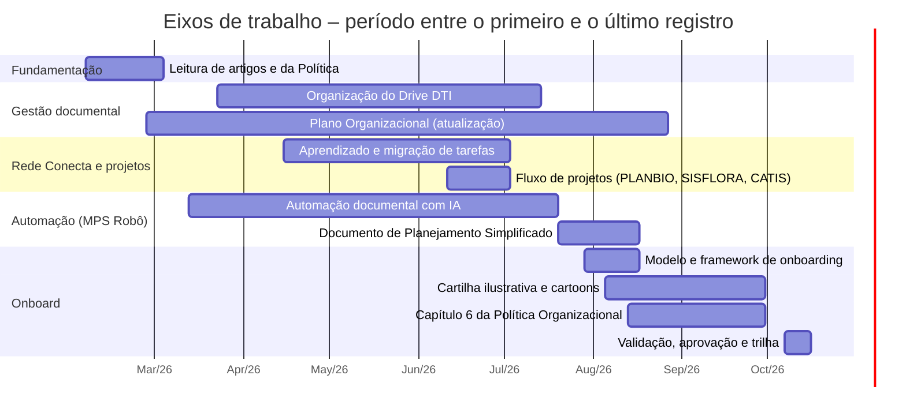

<!-- ===================================================================== -->
<!-- CAPA INSTITUCIONAL                                                      -->
<!-- ===================================================================== -->

  
  &nbsp;&nbsp;&nbsp;&nbsp;
  

 

<h1 align="center">Apresentação da Trajetória de Execução do Projeto Onboard</h1>

  <em>Registro cronológico das atividades, marcos e evidências do processo de integração de novos colaboradores (onboarding) da Diretoria de Tecnologia da Informação – DTI/SEMAS</em>

 

  <strong>Destinatário:</strong> Secretaria de Estado de Meio Ambiente, Clima e Sustentabilidade do Pará – SEMAS-PA 
  Diretoria de Tecnologia da Informação – DTI

  <strong>Período de referência:</strong> fevereiro a outubro de 2026 
  <strong>Elaboração:</strong> Mylena dos Reis Sobral 
  <strong>Data:</strong> 16 de outubro de 2026

Belém – PA

---

## Sumário

1. [Apresentação e contextualização](#1-apresentação-e-contextualização)
2. [Visão geral do cronograma](#2-visão-geral-do-cronograma)
3. [Trilha cronológica das atividades](#3-trilha-cronológica-das-atividades)
4. [Marcos e entregas de destaque](#4-marcos-e-entregas-de-destaque)
5. [Relação dos anexos](#5-relação-dos-anexos)
6. [Síntese da trajetória do projeto](#6-síntese-da-trajetória-do-projeto)
7. [Encerramento institucional](#7-encerramento-institucional)

---

## 1. Apresentação e contextualização

### 1.1. Propósito do projeto

O projeto Onboard tem por finalidade **construir um modelo de onboarding baseado em evidências científicas** para a DTI/SEMAS. Conforme a proposta apresentada ([Anexo 4](anexo4.pdf)), o modelo busca:

- reduzir o tempo de adaptação dos novos integrantes;
- facilitar a transferência de conhecimento;
- aumentar a autonomia dos novos integrantes;
- padronizar o processo de integração.

Esses objetivos foram incorporados à Política Organizacional da DTI, no **capítulo 6 – Processo de Integração de Novos Colaboradores (Onboarding)** ([Anexo 3](anexo3.pdf)), que acrescenta o alinhamento do colaborador aos objetivos e práticas da DTI e adota quatro metodologias: **Autoestudo, Mãos na Massa (Hands-on), Aprendizagem Baseada em Projetos e Integração**.

### 1.2. Contexto de execução

As atividades foram desenvolvidas junto à DTI/SEMAS, em interação com a área de Qualidade (QA), a Gerência de Desenvolvimento de Sistemas (GESIS), as coordenações da Diretoria e a orientação acadêmica. O trabalho ocorreu em paralelo a outras demandas da Diretoria, entre as quais:

- organização e padronização do repositório documental (Drive DTI);
- adoção da plataforma **Rede Conecta** para o registro de tarefas e projetos;
- apoio à automação documental com o **MPS Robô**, no contexto do modelo de qualidade **MPS.BR**;
- atualização do Plano Organizacional e da Política Organizacional da DTI.

Segundo o cronograma, a ausência de uma referência consolidada a onboarding na Política da DTI foi constatada em 05/08/2026. A primeira tentativa de diagnóstico, um questionário anônimo aplicado em 13/03/2026, **não foi bem aceita** pelos integrantes.

### 1.3. Finalidade desta apresentação

Demonstrar à SEMAS-PA a evolução das atividades ao longo dos meses, os principais marcos e as entregas realizadas, indicando para cada informação o documento que permite verificá-la.

> **Critério de leitura.** O [cronograma do projeto](cronograma%20do%20projeto.txt) é um registro cronológico das atividades, mantido pela própria executora. Ele orienta a estrutura temporal desta apresentação, mas, isoladamente, não comprova conclusão. Por isso são usadas as seguintes situações:
>
> | Situação | Significado |
> |---|---|
> | **Concluída** | Registrada como finalizada **e** com anexo que demonstra o produto ou o resultado |
> | **Registrada** | Atividade marcada como realizada no cronograma, sem anexo comprobatório entre os sete documentos |
> | **Em andamento** | Atividade iniciada cuja continuidade aparece em registros posteriores, sem conclusão documentada |
> | **Pendente** | Atividade ou validação aguardando ação, conforme os documentos |
> | **Não confirmada** | Prevista ou mencionada, sem registro de execução |

---

## 2. Visão geral do cronograma

### 2.1. Período identificado

O cronograma registra atividades de **05/02/2026 a 16/10/2026** (nove meses). Ele não divide o trabalho em etapas nomeadas: os registros estão organizados apenas por mês e data. Os eixos de trabalho a seguir são um **agrupamento editorial** feito a partir desses registros.

### 2.2. Distribuição dos eixos de trabalho

Cada barra vai do **primeiro ao último registro documentado** de cada eixo. Ela não indica dedicação contínua nem conclusão.

### 2.3. Planejamento e execução

| Referência de planejamento | Fonte | Registro de execução |
|---|---|---|
| Prazos de desenvolvimento até **julho/2026**, em razão de auditoria interna prevista | Cronograma, 15/04/2026 | A realização da auditoria **não consta** nos documentos |
| Finalização da atualização do Plano Organizacional até **18/06/2026** | Cronograma, 11/06/2026 | O cronograma registra ajustes no Plano em 13/07, 12/08 e 17/08/2026. A data de finalização **não foi confirmada** |
| Fluxo do projeto ID449 – Melhorias SISFLORA, com datas de 15/06 a 04/08/2026 | [Anexo 6](anexo6.png) | Na captura de tela, apenas o Termo de Abertura aparece como feito. As etapas seguintes **não têm conclusão confirmada** |
| Aplicação da Trilha de Onboarding a partir de **novembro/2026** | [Anexo 7](anexo7.pdf) (que ainda indica piloto em janeiro/2027) | Proposta aguardando validação; ainda não executada |

---

## 3. Trilha cronológica das atividades

### 3.1. Linha do tempo

```mermaid
flowchart LR
    FEV["<b>Fev/2026</b><br/>Leitura de artigos<br/>e da Política"]
    MAR["<b>Mar/2026</b><br/>Equipe de automação (IA)<br/>1º questionário"]
    ABR["<b>Abr/2026</b><br/>Estrutura de pastas<br/>validada"]
    MAI["<b>Mai/2026</b><br/>Migração de tarefas<br/>para a Rede Conecta"]
    JUN["<b>Jun/2026</b><br/>Fluxo de projetos<br/>na Rede Conecta"]
    JUL["<b>Jul/2026</b><br/>Documento de Planejamento<br/>Simplificado e diagnóstico"]
    AGO["<b>Ago/2026</b><br/>Modelo de onboarding<br/>aceito e cartilha"]
    SET["<b>Set/2026</b><br/>Cap. 6 da Política<br/>e cartilha v_03"]
    OUT["<b>Out/2026</b><br/>Pedido de aprovação<br/>e proposta de trilha"]

    FEV --> MAR --> ABR --> MAI --> JUN --> JUL --> AGO --> SET --> OUT
```

Os quadros abaixo detalham cada mês. A coluna **Evidência** indica o documento que sustenta a informação. **Cron.** remete ao [cronograma do projeto](cronograma%20do%20projeto.txt).

---

### Fevereiro/2026 — Ambientação e fundamentação

**Eixo predominante:** leitura de referências e conhecimento dos documentos da DTI.

| Data | Tarefa / ação | Resultado registrado | Evidência | Situação |
|---|---|---|---|---|
| 05/02 | Leitura dos artigos e da Política Organizacional; apoio à otimização dos projetos cadastrados na plataforma Conecta | **16 referências sobre onboarding catalogadas no Zotero** em 16/02/2026 | Cron.; [Anexo 8](Relat%C3%B3rio%20Zotero_pesquisa%20Mylena.htm) | **Concluída** (fundamentação) |
| 06/02 | Participação nos seminários semanais (sextas-feiras), conduzidos pela QA | — | Cron. | Registrada |
| 26/02 | Início do trabalho com o Plano Organizacional | Continuidade nos meses seguintes | Cron. | Em andamento |

**Entrega do mês:** base de referências científicas sobre onboarding, com 16 itens catalogados no Zotero ([Anexo 8](Relat%C3%B3rio%20Zotero_pesquisa%20Mylena.htm)).

---

### Março/2026 — Primeiro diagnóstico e automação de processos

**Eixo predominante:** fundamentação do conceito de onboarding e início da frente de automação.

| Data | Tarefa / ação | Resultado registrado | Evidência | Situação |
|---|---|---|---|---|
| 04/03 | Continuação da leitura dos artigos selecionados sobre onboarding; aulas extras de administração da informática | — | Cron. | Registrada |
| 13/03 | Início da equipe de Automatização de Processos (IA) | Continuidade em abril, junho e julho | Cron. | Em andamento |
| 13/03 | Primeira tentativa de questionário anônimo para medir a adesão dos novos integrantes | **Não foi bem aceito**, por receio dos integrantes em avaliar a DTI | Cron.; [Questionário 1 (Google Forms)](https://docs.google.com/forms/d/e/1FAIpQLScez3jmYZ9chfepjEBHlGyvm6wZskYbLvDevM1DS-1NGyf7yg/viewform) | **Concluída** (aplicado; resultado negativo) |
| 23/03 | Organização de pastas no Drive (ajustes pedidos e esclarecimento de dúvidas) | Continuidade em abril | Cron. | Em andamento |

**Entrega do mês:** primeiro questionário de adesão aplicado aos novos integrantes ([Questionário 1 – Google Forms](https://docs.google.com/forms/d/e/1FAIpQLScez3jmYZ9chfepjEBHlGyvm6wZskYbLvDevM1DS-1NGyf7yg/viewform)); não foi bem aceito pelos integrantes.

---

### Abril/2026 — Padronização da estrutura documental

**Eixo predominante:** organização do Drive DTI e alinhamento de prazos.

| Data | Tarefa / ação | Resultado registrado | Evidência | Situação |
|---|---|---|---|---|
| 08/04 | 2ª etapa de implementação de IA (MPS Robô) | — | Cron. | Registrada |
| 08/04 | Fim do Guia Prático de documentos no Rede Conecta | Guia não incluído entre os anexos | Cron. | Registrada |
| 15/04 | Alinhamento com a QA: prazos de desenvolvimento até julho, em razão de auditoria interna | Conversa com o Coordenador Eduardo sobre a rotina da Rede Conecta, marcada como feita | Cron. | Registrada |
| 16/04 | Envio, à QA, da proposta de organização de pastas do Drive para aprovação | **Estrutura de pastas validada com a Diretora**, com o Sistema Central de Postagens como piloto | [Anexo 1](anexo1.png) | **Concluída** |
| 17/04 | Seminário semanal; reunião com a equipe do SICAR sobre os cronogramas da Rede Conecta | — | Cron. | Registrada |

**Entrega do mês:** estrutura padronizada de pastas e subpastas (Sistemas → Documentação do Sistema; Demandas/Projetos → *PAE XXXXX – Versão XXXX*; Referências; Notas Técnicas; Legislação). A mesma estrutura aparece formalizada no **item 3.1** da Política Organizacional ([Anexo 3](anexo3.pdf)).

---

### Maio/2026 — Transição para a Rede Conecta

**Eixo predominante:** aprendizado da plataforma e migração das demandas.

| Data | Tarefa / ação | Resultado registrado | Evidência | Situação |
|---|---|---|---|---|
| 08/05 | Verificação, com a coordenação, dos responsáveis pelos projetos da planilha de demandas | Todos verificados e confirmados | Cron. | Registrada |
| 08/05 | Testes e aprendizado da Rede Conecta | — | Cron. | Registrada |
| 11/05 | Reunião com a QA e o Coordenador Eduardo sobre a segurança da Rede Conecta | Questão esclarecida pelo Coordenador; pauta de nova reunião com a Ascom | Cron. | Registrada |
| 12/05 | Verificação da transição das tarefas para a Rede Conecta | Orientação recebida: **criar tarefas** em vez de anexar arquivos do Drive | Cron. | Registrada |
| 12/05 | Verificação e início da criação de projetos na plataforma | **Demandas migradas para a Rede Conecta**, organizadas nos espaços *Demandas – CODES*, *Demandas CRISTI* e *Demandas Internas Sistemas* | Cron.; [Anexo 6](anexo6.png) | **Concluída** (migração) |
| 13/05 | Verificação de tarefas e subtarefas das demandas Conecta; repasse das demandas de atualização à QA | — | Cron. | Registrada |

**Entrega do mês:** demandas da DTI migradas para a Rede Conecta como tarefas e projetos ([Anexo 6](anexo6.png)).

---

### Junho/2026 — Fluxo de projetos na Rede Conecta

**Eixo predominante:** aplicação do fluxo de desenvolvimento da SEMAS em projetos reais.

| Data | Tarefa / ação | Resultado registrado | Evidência | Situação |
|---|---|---|---|---|
| 11/06 | Primeira tentativa de implantar subtarefas com o auxílio do MPS Robô | Redirecionamento para as tarefas concluídas do **Portal PLANBIO** (linha 115 da aba *Demandas Internas Concluídas*) | Cron. | Registrada |
| 11/06 | Orientação: atualização do Plano Organizacional prevista até 18/06/2026 | Intenção registrada de finalizar um guia do usuário do Drive DTI, com mapa infográfico | Cron. | Não confirmada |
| 16/06 | Adoção das tarefas do Portal PLANBIO (documentação da equipe, testes e checklist) | — | Cron. | Registrada |
| 17/06 | Apresentação, pela QA, do fluxo de desenvolvimento da SEMAS (sprint paralela a outras atividades): Termo de Abertura → Plano de Projeto → Lista de Requisitos → Planning → Desenvolvimento → Teste (QA) → Homologação | Fluxo registrado no quadro Kanban do projeto **ID449 – Melhorias SISFLORA** | [Anexo 6](anexo6.png) | **Em andamento** (ver nota) |
| 22/06 | Inclusão, na Rede Conecta, de tarefa relativa ao CATIS (PAE 2026041046), com abertura de nova guia | — | Cron. | Registrada |
| 29/06 | Verificação de arquivos do projeto CATIS/CODES e da modernização da plataforma CATIS/GLPI (atualização prevista da versão 10.0.9 para a 11.0.6 nos sistemas CATIS, CAES e SICOM) | A atualização é descrita como projeto a ser verificado | Cron. | Não confirmada |

> **Nota sobre o Anexo 6.** A captura de tela mostra o Termo de Abertura **feito** (15/06), o Plano de Projeto **em andamento (60%)** e a Lista de Requisitos **em andamento (10%)**. Planning, Desenvolvimento, Teste QA e Homologação aparecem **não iniciadas**, com datas de 01/07 a 04/08/2026. A data da captura não foi identificada, e a conclusão das etapas seguintes não está documentada.

**Entrega do mês:** projeto ID449 – Melhorias SISFLORA estruturado na Rede Conecta, segundo o fluxo de trabalho da DTI ([Anexo 6](anexo6.png)).

---

### Julho/2026 — Simplificação documental e diagnóstico para o Onboard

**Eixo predominante:** automação documental, novo template e preparação do modelo de onboarding.

| Data | Tarefa / ação | Resultado registrado | Evidência | Situação |
|---|---|---|---|---|
| 03/07 | Ajuste das logomarcas no sistema Rede Conecta (período eleitoral); inclusão dos links dos projetos CATIS-CODES e CATIS-GRECO; verificação de documentos do App SEMAS | — | Cron. | Registrada |
| 13/07 | Elaboração de anexo sobre ex-colaboradores para a atualização do Plano Organizacional; proposta de incluir o uso do MPS Robô e o fluxograma de gestão documental | Documento não incluído entre os anexos desta apresentação | Cron. | Registrada |
| 14–15/07 | Verificação do fluxograma de documentos da DTI; acompanhamento da produção de documentos curtos com o MPS Robô | — | Cron. | Registrada |
| 20/07 | Projeto piloto de automação: análise de 3 documentos e identificação dos itens essenciais de um projeto segundo o MPS.BR, a validar com a QA e encaminhar ao programador de IA | — | Cron. | Registrada |
| 20–22/07 | Apoio ao novo template **Documento de Planejamento Simplificado (DPS) – SEMAS/PA**, que resume em uma página o Termo de Abertura, a Lista de Requisitos e o Plano de Projeto | Template com data de 20/07/2026 | [Anexo 2](anexo2.pdf) | Em andamento (consolidado em agosto) |
| 29/07 | Preparação da reunião sobre a aplicação do Onboard; levantamento dos métodos de onboarding já praticados na DTI; seleção de até 3 possibilidades de aplicação | — | Cron. | Registrada |
| 30/07 | Inspeção de 13 itens de mídia digital da área *Onboarding* do Drive (cartoons e vídeos sobre a Política e o Plano Organizacional); relatório sobre o sistema CATIS voltado à preparação de um novo framework de onboarding | Relatório não incluído entre os anexos | Cron. | Registrada |

> As sextas-feiras de julho foram facultativas. Não houve atividades nos dias 10, 17, 24 e 31/07.

**Entrega do mês:** primeira versão do template de Documento de Planejamento Simplificado ([Anexo 2](anexo2.pdf)).

---

### Agosto/2026 — Modelo de onboarding aceito e produção de materiais

**Eixo predominante:** proposição, validação e materialização do framework de onboarding.

| Data | Tarefa / ação | Resultado registrado | Evidência | Situação |
|---|---|---|---|---|
| 04/08 | Apresentação, à QA e ao Gerente Eduardo, do modelo experimental de onboarding: processo de integração de novos membros à equipe, voltado ao público interno da DTI | **Modelo de onboarding aceito** pelos gerentes | Cron.; conteúdo correspondente no [Anexo 4](anexo4.pdf) ¹ | **Concluída** |
| 05/08 | Análise do modelo de curso do CAR na Rede Conecta, como referência para um possível curso sobre o CATIS (sujeito a autorização) | — | Cron. | Registrada |
| 05/08 | Busca de conceitos de onboarding na Política da DTI | Nenhuma referência consolidada encontrada | Cron. | Registrada |
| 05–17/08 | Proposição do framework de integração (onboarding), apresentado à GESIS e à QA; inclusão do conteúdo no Plano e na Política Organizacional | Política Organizacional revisada em 13/08/2026 (v4.1), com a inclusão do processo de onboarding | [Anexo 3](anexo3.pdf) ² | **Concluída** (inclusão no documento) |
| 05–17/08 | Desenvolvimento de cartoons da Política Organizacional da DTI, para uso experimental com novos integrantes | Cartilha Ilustrativa da Política Organizacional | [Anexo 5](anexo5.pdf) | **Concluída** (versão apresentada) |
| até 17/08 | Desenvolvimento do template *Documento de Planejamento Simplificado – SEMAS/PA*, com o objetivo de agilizar a documentação | Template estruturado em 4 seções (identificação, escopo, planejamento e riscos, cronograma e responsáveis) | [Anexo 2](anexo2.pdf) | **Concluída** (template) |
| 26–27/08 | Reunião com a QA, o consultor e o gerente sobre o material de Onboard | Avaliação positiva, com ajustes recomendados: termos dos balões de diálogo e retirada da pirâmide de prioridades (tópico 7 da Cartilha Onboard v2.0) | Cron. | Registrada |
| 31/08 | Avaliação qualitativa de formulário, para análise do consultor e da QA | Formulário não incluído entre os anexos | Cron. | Registrada |

¹ O Anexo 4 não traz data. A correspondência com a apresentação de 04/08 foi feita pelo conteúdo (objetivos, base científica e plano de 4 semanas) e **precisa ser confirmada**.
² O cronograma cita "Plano Organizacional 5.0" e "Política Organizacional 4.0". A versão da Política com o onboarding, porém, é posterior à 4.0 (ver item 6.3).

**Entregas do mês:** modelo experimental de onboarding aceito ([Anexo 4](anexo4.pdf)); Cartilha Ilustrativa ([Anexo 5](anexo5.pdf)); template Documento de Planejamento Simplificado ([Anexo 2](anexo2.pdf)); processo de onboarding incluído na Política Organizacional ([Anexo 3](anexo3.pdf)).

---

### Setembro/2026 — Consolidação textual da Política e da Cartilha

**Eixo predominante:** revisão e finalização dos textos de onboarding.

| Data | Tarefa / ação | Resultado registrado | Evidência | Situação |
|---|---|---|---|---|
| 02/09 | Reunião com o consultor | **Adiada** | Cron. | Não realizada na data |
| 02–03/09 | Revalidação do texto da Política Organizacional sobre o onboarding | Revisão 4.2 da Política, datada de 03/09/2026 | [Anexo 3](anexo3.pdf) | **Concluída** (revisão) |
| 02–30/09 | Duas reuniões sobre a finalização textual do processo de onboarding; elaboração de questionário para aplicação aos gestores | Questionário elaborado; aplicação e respostas não documentadas | Cron.; [Questionário 2 (Google Forms)](https://docs.google.com/forms/d/e/1FAIpQLSfD8W7ThutfpAbvTlPxeyx8G5saRa3qm-bC4NktzwrFkdC7pg/viewform) | Registrada |
| 02–30/09 | Versão v_03 da Cartilha da Política Organizacional da DTI | A versão do Anexo 5 não está identificada no texto do arquivo | Cron.; [Anexo 5](anexo5.pdf) | Registrada (versão a confirmar) |
| 02–30/09 | Conclusão da edição do **capítulo 6 – Processo de Integração de Novos Colaboradores** da Política Organizacional | Capítulo presente no documento (págs. 13–14) | [Anexo 3](anexo3.pdf) | **Concluída** (redação) |

**Entrega do mês:** capítulo 6 da Política Organizacional da DTI, com objetivos e metodologias de onboarding ([Anexo 3](anexo3.pdf)).

---

### Outubro/2026 — Encaminhamento para aprovação e proposta de trilha

**Eixo predominante:** validação institucional e preparação da implantação.

| Data | Tarefa / ação | Resultado registrado | Evidência | Situação |
|---|---|---|---|---|
| 07/10 | Envio de e-mail à Diretora da DTI solicitando a aprovação da nova Política e da Cartilha | E-mail não incluído entre os anexos; aprovação não documentada | Cron. | **Pendente** (aguardando aprovação) |
| 09/10 | Verificação dos documentos gerados para a Rede Conecta sobre o onboarding: proposta de trilha a ser incluída na plataforma | Aguardando verificação dos gerentes, da QA, do consultor e da Diretora | Cron.; [Anexo 7](anexo7.pdf) | **Pendente** (validação) |
| 09/10 | Entrega dos relatórios de agosto e setembro | Item **não marcado** como realizado | Cron. | **Pendente** |
| 14/10 | Reunião de todos os documentos para apresentação ao orientador | — | Cron. | Registrada |
| 16/10 | Reunião de documentos e apresentação dos resultados | Esta apresentação | Cron. | Em andamento |

**Entrega do mês:** proposta técnica da **Trilha de Aprendizagem de Onboarding com conceito de Universidade Corporativa** ([Anexo 7](anexo7.pdf)), com 3 módulos e carga horária estimada de 30 h, ainda em validação.

---

## 4. Marcos e entregas de destaque

Foram selecionados apenas os marcos que têm um documento verificável entre os anexos.

| # | Marco | Período | Importância para o projeto | Verificação |
|---|---|---|---|---|
| 1 | **Fundamentação científica sobre onboarding** | fev/2026 | Base de 16 referências que sustenta o modelo de onboarding e suas metodologias (autoestudo, hands-on, aprendizagem baseada em projetos) | [Anexo 8](Relat%C3%B3rio%20Zotero_pesquisa%20Mylena.htm) |
| 2 | **Estrutura padronizada de pastas do Drive validada** | 16/04/2026 | Estabeleceu a organização documental dos projetos (por sistema e por PAE/versão), base para localizar documentos e preservar o conhecimento. Foi incorporada ao item 3.1 da Política | [Anexo 1](anexo1.png); [Anexo 3](anexo3.pdf), item 3.1 |
| 3 | **Migração das demandas e fluxo de projetos na Rede Conecta** | mai–jun/2026 | Demandas da DTI passaram a ser geridas como tarefas e projetos na plataforma, e o fluxo de desenvolvimento (Termo de Abertura → Homologação) foi aplicado a um projeto real (ID449 – SISFLORA) | [Anexo 6](anexo6.png) |
| 4 | **Template Documento de Planejamento Simplificado – SEMAS/PA** | 20/07 a 17/08/2026 | Condensa em um único documento os artefatos de planejamento, com vistas à agilidade documental | [Anexo 2](anexo2.pdf) |
| 5 | **Modelo experimental de Onboard aceito pela gestão** | 04/08/2026 | Definiu os objetivos, a base científica (gestão do conhecimento com IA, autoestudo, tutoriais hands-on e aprendizagem baseada em projetos) e o plano de 4 semanas | [Anexo 4](anexo4.pdf); cronograma |
| 6 | **Cartilha Ilustrativa da Política Organizacional** | ago a set/2026 | Material didático e visual para apresentar a DTI aos novos integrantes (estrutura, serviços, processos e princípios) | [Anexo 5](anexo5.pdf) |
| 7 | **Onboarding institucionalizado na Política Organizacional (cap. 6)** | 13/08 a 30/09/2026 | Tornou o onboarding uma diretriz formal da DTI, com objetivos e quatro metodologias. Mylena Reis consta entre os autores das revisões | [Anexo 3](anexo3.pdf), págs. 1 e 13–14 |
| 8 | **Proposta de Trilha de Aprendizagem de Onboarding na Rede Conecta** | out/2026 (em validação) | Traduz a Política em trilha de 30 h (3 módulos), com avaliação, certificação, indicadores e aplicação a partir de nov/2026 | [Anexo 7](anexo7.pdf) |

---

## 5. Relação dos anexos

### 5.1. Índice

| Nº | Arquivo | Documento |
|---|---|---|
| 1 | [anexo1.png](anexo1.png) | E-mail de validação da estrutura de pastas do Drive |
| 2 | [anexo2.pdf](anexo2.pdf) | Template – Documento de Planejamento Simplificado – SEMAS/PA |
| 3 | [anexo3.pdf](anexo3.pdf) | Política Organizacional da DTI/SEMAS |
| 4 | [anexo4.pdf](anexo4.pdf) | Onboard – Proposta |
| 5 | [anexo5.pdf](anexo5.pdf) | Cartilha Ilustrativa da Política Organizacional da DTI |
| 6 | [anexo6.png](anexo6.png) | Quadro Kanban da Rede Conecta – ID449 Melhorias SISFLORA |
| 7 | [anexo7.pdf](anexo7.pdf) | Proposta Técnica – Trilha de Aprendizagem de Onboarding |
| 8 | [Relatório Zotero_pesquisa Mylena.htm](Relat%C3%B3rio%20Zotero_pesquisa%20Mylena.htm) | Relatório Zotero – referências da pesquisa sobre onboarding |
| — | [cronograma do projeto.txt](cronograma%20do%20projeto.txt) | Cronograma do projeto (referência temporal; não integra a numeração dos anexos) |

### 5.2. Descrição dos anexos

Os anexos estão ordenados por **função**, dos documentos normativos aos registros operacionais.

#### Fundamentação científica

**Anexo 8 — [Relatório Zotero – pesquisa sobre onboarding](Relat%C3%B3rio%20Zotero_pesquisa%20Mylena.htm)** · `Relatório Zotero_pesquisa Mylena.htm`
- **Tipo:** relatório exportado do gerenciador de referências Zotero (página HTML).
- **Conteúdo:** 16 referências sobre onboarding, socialização organizacional e gestão do conhecimento em engenharia de software (artigos, revisões, conferências e teses), com resumo, DOI/URL e data de catalogação. Todos os itens foram adicionados em 16/02/2026; entre eles está Schilling et al. (2022), citado na proposta do [Anexo 4](anexo4.pdf).
- **Relacionado a:** fevereiro e março (leitura dos artigos e fundamentação do conceito de onboarding).

#### Documentos normativos e materiais de onboarding

**Anexo 3 — [Política Organizacional da DTI/SEMAS](anexo3.pdf)** · `anexo3.pdf`
- **Tipo:** documento normativo institucional (PDF, 29 páginas).
- **Conteúdo:** histórico de versões (1.0, de 04/07/2024, a 4.2, de 03/09/2026); estrutura organizacional; padronização da documentação e estrutura de pastas dos projetos (item 3.1); modalidades de projeto padrão e simplificado (item 5.1); **capítulo 6 – Processo de Integração de Novos Colaboradores (Onboarding)**; qualidade, gerência de configuração e conformidade.
- **Relacionado a:** abril (estrutura de pastas), agosto e setembro (onboarding na Política).

**Anexo 4 — [Onboard – Proposta](anexo4.pdf)** · `anexo4.pdf`
- **Tipo:** apresentação de slides (PDF, 11 páginas), de autoria de Mylena dos Reis Sobral.
- **Conteúdo:** objetivos do modelo de onboarding; base científica (Georgiev; Schilling et al.; Reinsvold Hall et al.); gestão do conhecimento com IA, tutoriais hands-on e aprendizagem baseada em projetos; plano de aplicação na SEMAS em 4 semanas.
- **Relacionado a:** julho e agosto (modelo experimental apresentado e aceito em 04/08).

**Anexo 5 — [Cartilha Ilustrativa da Política Organizacional da DTI](anexo5.pdf)** · `anexo5.pdf`
- **Tipo:** cartilha ilustrativa (PDF, 6 páginas).
- **Conteúdo:** apresentação didática da DTI ("Conhecer · Compreender · Aplicar · Evoluir"): estrutura, missão, serviços, processos, princípios e glossário de siglas (SAGAT, GESIS, CODES, CATIS, PAE, BPMN etc.).
- **Relacionado a:** agosto e setembro (cartoons e versões da cartilha).

**Anexo 7 — [Proposta Técnica – Trilha de Aprendizagem de Onboarding](anexo7.pdf)** · `anexo7.pdf`
- **Tipo:** proposta técnica (PDF, 10 páginas).
- **Conteúdo:** trilha baseada no conceito de Universidade Corporativa, na Rede Conecta; 3 módulos (8 h, 12 h e 10 h); metodologias; avaliação e certificação; papéis; governança; cronograma de piloto para janeiro/2027 (a aplicação foi antecipada para novembro/2026; ver item 6.3); indicadores; riscos.
- **Relacionado a:** outubro (proposta de trilha em validação).

#### Instrumentos de gestão de projetos

**Anexo 2 — [Documento de Planejamento Simplificado – SEMAS/PA](anexo2.pdf)** · `anexo2.pdf`
- **Tipo:** template documental (PDF, 2 páginas).
- **Conteúdo:** modelo de uma folha com identificação e justificativa, escopo e requisitos, planejamento e riscos, cronograma e responsáveis, com campos para preenchimento. Data de 20/07/2026.
- **Relacionado a:** julho e agosto.

**Anexo 6 — [Quadro Kanban da Rede Conecta – ID449 Melhorias SISFLORA](anexo6.png)** · `anexo6.png`
- **Tipo:** captura de tela da plataforma Rede Conecta.
- **Conteúdo:** espaços *Demandas – CODES*, *Demandas CRISTI* e *Demandas Internas Sistemas*; quadro do projeto ID449 com as etapas do fluxo de desenvolvimento, datas e percentuais de andamento.
- **Relacionado a:** maio (migração das demandas para a Rede Conecta) e junho (fluxo de trabalho da SEMAS, 17/06).

#### Registros de comunicação

**Anexo 1 — [E-mail de validação da estrutura de pastas do Drive](anexo1.png)** · `anexo1.png`
- **Tipo:** captura de tela de e-mail (16/04/2026).
- **Conteúdo:** solicitação de aprovação das modificações no Drive e resposta da Analista de Qualidade de TI com a estrutura complementar validada com a Diretora (piloto: Sistema Central de Postagens).
- **Relacionado a:** abril (16/04).

#### Documento de referência temporal

**[Cronograma do projeto](cronograma%20do%20projeto.txt)** · `cronograma do projeto.txt`
- **Tipo:** registro cronológico de atividades (texto).
- **Conteúdo:** registros datados de 05/02/2026 a 16/10/2026, com referências explícitas a `[anexo1]`, `[anexo2]`, `[anexo3]` e `[anexo5]`, e os endereços dos dois questionários.

#### Questionários (formulários on-line)

- **[Questionário 1 — adesão de novos integrantes](https://docs.google.com/forms/d/e/1FAIpQLScez3jmYZ9chfepjEBHlGyvm6wZskYbLvDevM1DS-1NGyf7yg/viewform)** (Google Forms): aplicado em 13/03/2026 ao público de novos integrantes; não foi bem aceito.
- **[Questionário 2 — gestores](https://docs.google.com/forms/d/e/1FAIpQLSfD8W7ThutfpAbvTlPxeyx8G5saRa3qm-bC4NktzwrFkdC7pg/viewform)** (Google Forms): elaborado em setembro/2026 para aplicação aos gestores. O cronograma registra a data como "02/09/29", lida aqui como 02/09/2026.
- **Relacionado a:** todos os meses.

---

## 6. Síntese da trajetória do projeto

### 6.1. Evolução das atividades

A trajetória documentada tem três fases sucessivas:

1. **Fev–mai/2026: ambientação e organização.** Leitura das referências e da Política, primeira tentativa de diagnóstico (questionário mal aceito), padronização do Drive (validada em 16/04) e transição das demandas para a Rede Conecta.
2. **Jun–jul/2026: processos e instrumentos.** Aplicação do fluxo de desenvolvimento da DTI em projetos reais (PLANBIO, SISFLORA, CATIS), apoio à automação documental com o MPS Robô, criação do template de planejamento simplificado e diagnóstico das práticas de onboarding existentes.
3. **Ago–out/2026: o Onboard propriamente dito.** Aceitação do modelo experimental (04/08), produção da Cartilha Ilustrativa, inclusão do processo de onboarding na Política Organizacional (revisões de 13/08 e 03/09), proposta de trilha na Rede Conecta e encaminhamento para aprovação (07/10).

### 6.2. Planejamento e execução

- O cronograma funciona mais como **registro de execução** do que como plano prévio: não há etapas nomeadas nem metas por mês.
- As principais entregas de agosto e setembro estão **demonstradas nos anexos** (Anexos 2, 3, 4 e 5).
- As etapas de junho a outubro dependem de validações de terceiros (gestão, QA, consultoria, Diretoria). Parte delas permanece **pendente**.

### 6.3. Pontos que necessitam de validação

| # | Ponto | Documentos envolvidos | Encaminhamento sugerido |
|---|---|---|---|
| 1 | O período identificado vai de **fevereiro** a outubro/2026, não de abril a outubro | Cronograma | Confirmar se a apresentação deve abranger todo o período ou só a fase de abril a outubro |
| 2 | O cronograma (05/08) associa o "relatório de Onboard para o framework" ao `[anexo5]`, mas o Anexo 5 é a Cartilha Ilustrativa | Cronograma; Anexo 5 | Confirmar se o relatório corresponde ao Anexo 4 ou a outro documento não anexado |
| 3 | O cronograma (17/08) cita "Política Organizacional 4.0" e "Plano Organizacional 5.0". No Anexo 3, a versão 4.0 é de 26/02/2026, e o onboarding aparece nas revisões 4.1 (13/08) e 4.2 (03/09) | Cronograma; Anexo 3 | Confirmar a versão vigente da Política e a versão do Plano Organizacional (não anexado) |
| 4 | Na tabela de versões do Anexo 3, a extração do texto não permite associar com segurança cada alteração (inclusive a "inclusão do processo de onboarding") à versão 4.1 ou 4.2 | Anexo 3 | Conferir visualmente a pág. 1 do documento |
| 5 | A aplicação da trilha foi definida para **a partir de novembro/2026**, mas o Anexo 7 ainda traz o cronograma de piloto em janeiro/2027 (item 18) | Anexo 7 | Atualizar o cronograma do Anexo 7 para novembro/2026 |
| 6 | O "Anexo 3" citado no cronograma em 13/07 (ex-colaboradores) é um anexo do Plano Organizacional, **não** o Anexo 3 desta apresentação | Cronograma | Manter a distinção na apresentação oral |
| 7 | O Anexo 4 não tem data e contém o texto "INGOUDE COMPANY", aparentemente um resíduo do modelo de slides | Anexo 4 | Revisar o slide antes de uma apresentação externa |
| 8 | A versão da cartilha no Anexo 5 (v2.0 ou v_03) não está identificada no texto | Cronograma; Anexo 5 | Confirmar qual versão foi anexada |
| 9 | A data da captura de tela do Anexo 6 não foi identificada, e as etapas posteriores do SISFLORA não têm conclusão documentada | Anexo 6 | Informar a data da captura ou anexar o quadro atualizado |
| 10 | Não há registro da auditoria interna prevista para julho/2026 | Cronograma (15/04) | Confirmar se a auditoria ocorreu |
| 11 | A aprovação da nova Política e da Cartilha (solicitada em 07/10) e a validação da trilha (09/10) **não estão documentadas** | Cronograma | Anexar a resposta da Diretoria quando houver |
| 12 | Os relatórios de agosto e setembro constam como **não entregues** | Cronograma (09/10) | Registrar a entrega quando ocorrer |
| 13 | Os documentos usam "Secretaria de Estado de Meio Ambiente, **Clima** e Sustentabilidade", mas a introdução da Cartilha (Anexo 5) usa "Meio Ambiente e Sustentabilidade" | Anexos 2, 3, 5 e 7 | Padronizar a denominação na Cartilha |
| 14 | No Anexo 3, a numeração repete o número 7 (item "7- Processo de Aquisição…" e item "7 Análise de Desempenho…") | Anexo 3 | Ajustar na próxima revisão |

---

## 7. Encerramento institucional

Esta apresentação reuniu, em ordem cronológica, as atividades registradas de fevereiro a outubro de 2026 junto à DTI/SEMAS. A trajetória vai da organização documental e da adoção da Rede Conecta até a institucionalização do processo de onboarding na Política Organizacional da Diretoria.

As entregas centrais do projeto Onboard (o modelo aceito pela gestão, a Cartilha Ilustrativa, o capítulo 6 da Política Organizacional e a proposta de Trilha de Aprendizagem) estão disponíveis nos anexos para consulta e verificação.

**Próximos passos documentados**, todos sujeitos a validação:

- aprovação, pela Diretoria da DTI, da nova Política e da Cartilha (solicitada em 07/10/2026);
- verificação da proposta de trilha pelos gerentes, pela QA, pelo consultor e pela Diretoria (09/10/2026);
- entrega dos relatórios de agosto e setembro (pendente em 09/10/2026);
- oficina de validação e aplicação da Trilha de Onboarding na Rede Conecta **a partir de novembro de 2026** ([Anexo 7](anexo7.pdf), itens 18 e 27, cujo cronograma ainda indica janeiro de 2027).

 

<em>Secretaria de Estado de Meio Ambiente, Clima e Sustentabilidade do Pará – Diretoria de Tecnologia da Informação</em> Belém – PA, 16 de outubro de 2026

